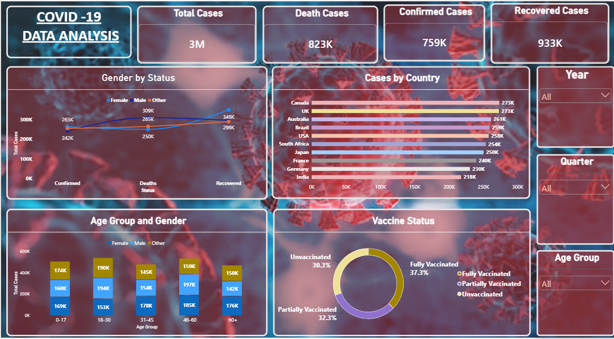

# powerbi-covid-dashboard
Interactive Power BI dashboard analysing COVID-19 cases by country, age group, gender and vaccination status.
# COVID-19 Interactive Dashboard (Power BI)

## Overview
An interactive Power BI dashboard that analyses COVID-19 cases across 
countries, age groups, gender and vaccination status.

## Dataset
- **File:** COVID.xlsx (sheet: covid_data)
- **Size:** 1,000 rows
- **Columns:** Date, Country, State, Status, Cases, Age Group, Gender, 
  Vaccine Status

## Visuals
| Visual | Shows |
|---|---|
| Line chart | Gender by Status |
| Clustered bar chart | Cases by Country |
| Stacked column chart | Cases by Age Group and Gender |
| Donut chart | Vaccine Status by Cases |

## Slicers
- Year
- Quarter
- Age Group

All visuals respond to the slicers, so the dashboard is fully interactive.

## Dashboard Preview

## Key Insights
- UK and Canada recorded the highest number of cases among all countries.
- The country with the most cases varies by age group: USA (0-17), South Africa (18-30), France (31-45), and Japan and Australia (46-60).
- Female patients accounted for more cases than male patients.
- 30.3% of cases were unvaccinated and 37.3% were fully vaccinated.

## Tools Used
Power BI Desktop, Excel
